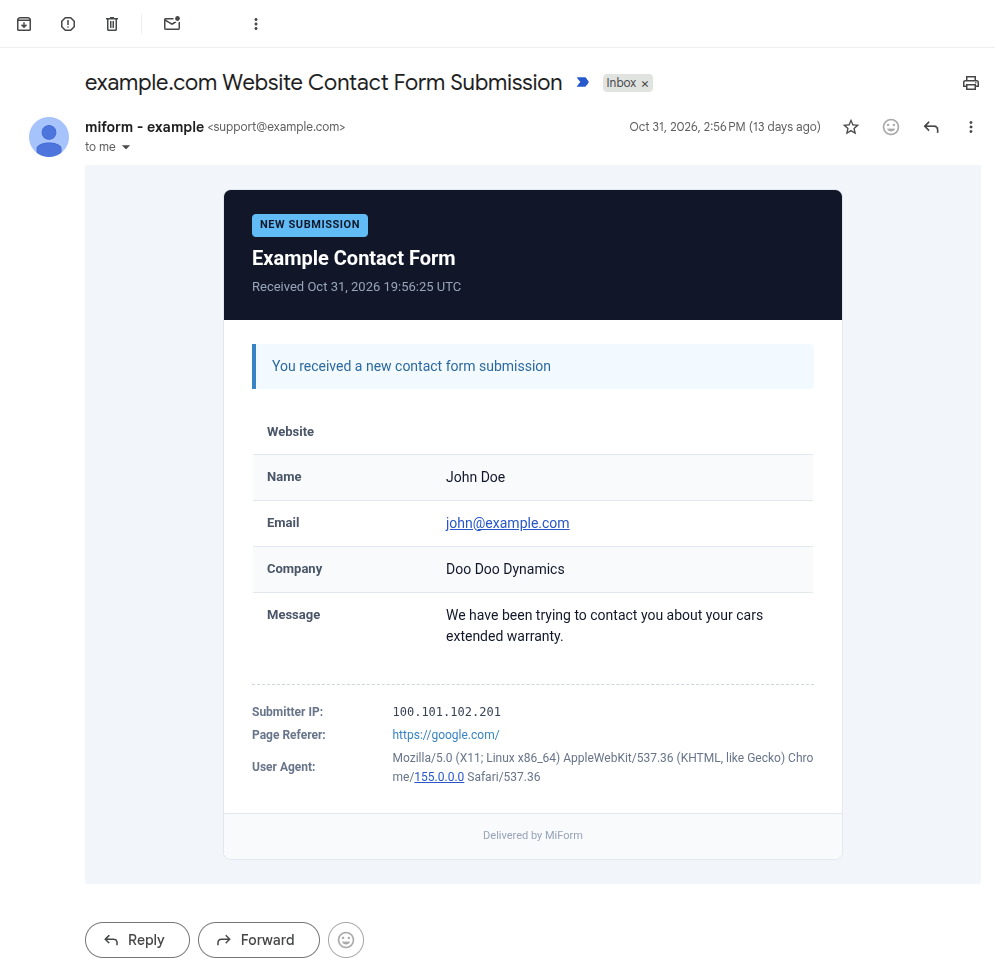

<div align="center">

# MiForm

**A lightweight, self-hosted, headless form backend service built on top of [PocketBase](https://pocketbase.io/).**
<br />
*An open-source, private, and fully customizable alternative to hosted services like Web3Forms and Formspree.*

<br />



</div>

## Features

- **Headless & Zero Frontend Required**: Accept submissions via standard HTML `<form>` POST, AJAX `fetch()`, or PocketBase REST collection hooks.
- **Multiple Payload Formats**: Seamlessly handles `application/json`, `application/x-www-form-urlencoded`, and `multipart/form-data`.
- **Flexible Form Routing**: Route submissions using a hidden `access_key` input or directly through URL path parameters: `/submit/{access_key}`.
- **Clean Email Notifications**: Sends responsive HTML and clean plaintext emails with humanized field labels, preserving exact form input ordering.
- **Security & Spam Protection**:
  - Built-in honeypot field (`botcheck`) that silently catches bots without frustrating users.
  - Automatic rejection and spam-flagging of submissions containing raw HTML links (`<a>` tags).
  - Allowed origin/referer domain verification with wildcard subdomain support.
  - Cloudflare Turnstile CAPTCHA support.
  - Built-in rate limiting on `/submit`.
  - Trusted proxy header resolution (configured for Cloudflare's `CF-Connecting-IP`).
- **Custom Redirections**: Redirect users to a custom thank-you page or fall back to the built-in `/submit/success` confirmation page.
- **Autoresponder Support**: Optional automatic confirmation email sent back to respondents who provide their email address.
- **Audit Trail**: Every submission is archived in the `submissions` PocketBase collection with status tracking (`sent`, `spam`, `failed`).

---

## Quick Start with Docker

### Docker Run

```bash
docker run -d \
  --name miform \
  -p 8090:8090 \
  -v $(pwd)/pb_data:/pb/pb_data \
  -e POCKETBASE_SUPERUSER_EMAIL="admin@example.com" \
  -e POCKETBASE_SUPERUSER_PASSWORD="ChangeMeToAStrongPassword123!" \
  ghcr.io/victorioberra/miform-pocketbase:latest
```

### Docker Compose

Create a `docker-compose.yml` file:

```yaml
services:
  miform:
    image: ghcr.io/victorioberra/miform-pocketbase:latest
    container_name: miform
    restart: unless-stopped
    ports:
      - "8090:8090"
    volumes:
      - ./pb_data:/pb/pb_data
    environment:
      - POCKETBASE_SUPERUSER_EMAIL=admin@example.com
      - POCKETBASE_SUPERUSER_PASSWORD=ChangeMeToAStrongPassword123!
      # Optional: Cloudflare Turnstile fallback secret key
      # - TURNSTILE_SECRET_KEY=0x4AAAAAA...
```

Start the service:

```bash
docker compose up -d
```

Access the admin dashboard at `http://localhost:8090/_/` using the superuser email and password specified above to configure your application metadata and SMTP settings (**Settings**), create forms, and view submissions.

---

## Environment Variables

| Variable | Description | Example / Default | Required |
| :--- | :--- | :--- | :---: |
| `POCKETBASE_SUPERUSER_EMAIL` | Auto-created superuser admin email | `admin@example.com` | Yes |
| `POCKETBASE_SUPERUSER_PASSWORD` | Auto-created superuser admin password | `SuperSecretPassword!` | Yes |
| `TURNSTILE_SECRET_KEY` | Default Cloudflare Turnstile secret key for forms with Turnstile enabled | `0x4AAAAAA...` | No |

> [!NOTE]
> **Settings & Configuration**: Application metadata (app name, public URL, sender name and email), outbound SMTP email delivery, and automated S3 backups can all be configured directly inside the PocketBase admin UI under **Settings**.

---

## Form Integration & Usage

### Standard HTML Form

```html
<form action="https://your-miform-domain.com/submit" method="POST">
  <!-- Required: Your Form's Access Key -->
  <input type="hidden" name="access_key" value="YOUR_ACCESS_KEY_HERE" />

  <!-- Optional Customizations -->
  <input type="hidden" name="subject" value="New Customer Inquiry" />
  <input type="hidden" name="redirect" value="https://example.com/thanks.html" />

  <!-- Honeypot field for anti-spam (hide with CSS) -->
  <input type="checkbox" name="botcheck" style="display: none;" />

  <!-- Standard Form Fields -->
  <label for="name">Name</label>
  <input type="text" id="name" name="name" required />

  <label for="email">Email Address</label>
  <input type="email" id="email" name="email" required />

  <label for="message">Message</label>
  <textarea id="message" name="message" required></textarea>

  <button type="submit">Submit Form</button>
</form>
```

> **Tip**: You can also route directly in the URL: `<form action="https://your-miform-domain.com/submit/YOUR_ACCESS_KEY" method="POST">`

### AJAX / Fetch API (JSON)

```javascript
const response = await fetch("https://your-miform-domain.com/submit", {
  method: "POST",
  headers: {
    "Content-Type": "application/json",
    "Accept": "application/json"
  },
  body: JSON.stringify({
    access_key: "YOUR_ACCESS_KEY_HERE",
    name: "Alex Doe",
    email: "alex@example.com",
    message: "I am interested in your services."
  })
});

const result = await response.json();
if (result.success) {
  console.log("Form successfully submitted!", result.data);
} else {
  console.error("Submission failed:", result.message);
}
```

### Reserved Control Fields

The following fields can be passed as form inputs to control submission behavior:

| Field Name | Description | Example |
| :--- | :--- | :--- |
| `access_key` | Form public identifier (required unless provided in URL path) | `my-website-contact` |
| `subject` | Overrides the default notification email subject line | `Inquiry from Pricing Page` |
| `from_name` | Overrides the sender display name in notifications | `Acme Contact Form` |
| `reply_to` | Overrides the email address set in the `Reply-To` header | `visitor@example.com` |
| `cc_email` | Additional email addresses to CC on this submission | `manager@example.com` |
| `redirect` | Custom URL to redirect the user to after submission | `https://example.com/thank-you` |
| `botcheck` | Anti-spam honeypot. If filled or checked, submission is flagged as spam | Hidden checkbox or text input |
| `intro_text` | Custom text paragraph shown above fields in the notification email | `A new quote request has arrived:` |
| `cf-turnstile-response` | Cloudflare Turnstile token for verification | Generated by Turnstile widget |

---

## Developing Locally

### Prerequisites

- [Go](https://go.dev/dl/) 1.23+
- [Docker](https://www.docker.com/) (optional)

### Running Locally

```bash
# Clone the repository
git clone https://github.com/VictorioBerra/miform.git
cd miform

# Copy and configure environment variables
cp .env.example .env

# Run PocketBase server
go run . serve
```

Run tests:

```bash
go test -v ./...
```

---

## License & Disclaimer

This project is licensed under the [MIT License](LICENSE).

*Disclaimer: MiForm is an independent open-source project and is not affiliated with, endorsed by, or associated with Web3Forms or Formspree. Product and company names are trademarks™ or registered® trademarks of their respective holders.*
